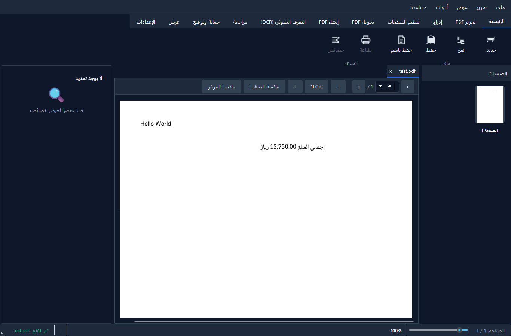
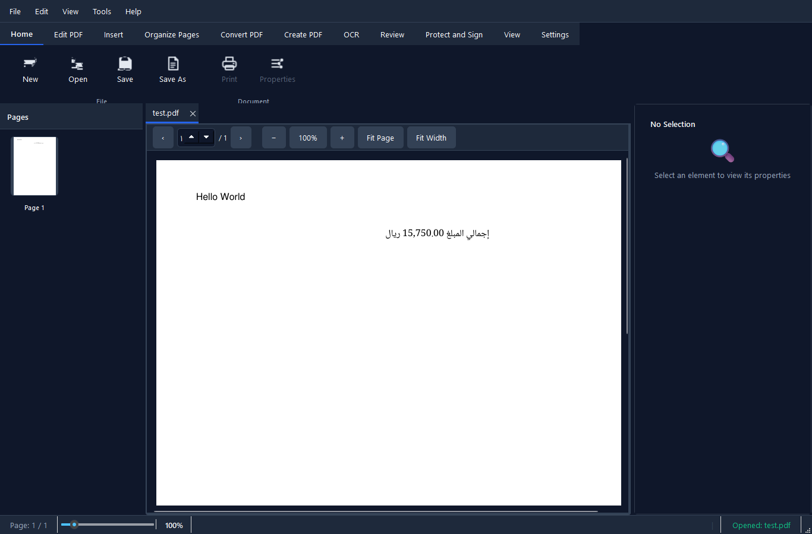
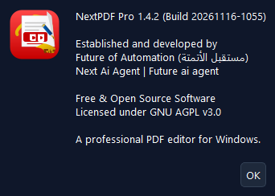
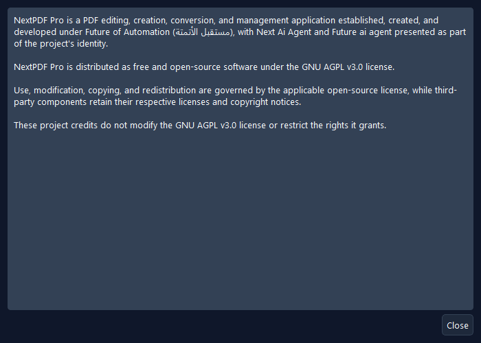
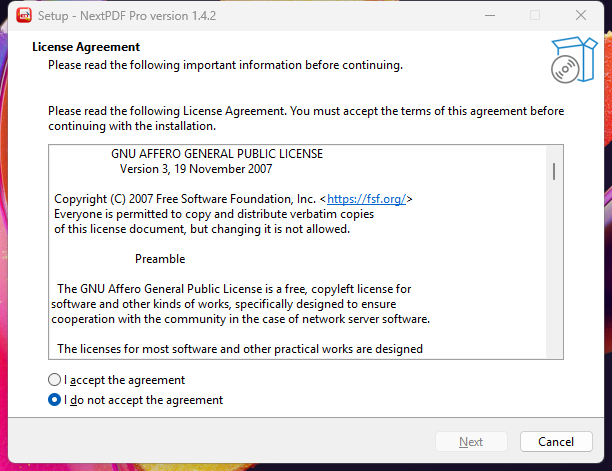

# NextPDF Pro

[](https://github.com/hossamxp2025/NextPDF-Pro/releases/latest)
[](https://github.com/hossamxp2025/NextPDF-Pro/releases)
[](LICENSE)


**[⬇️ Download the latest release](https://github.com/hossamxp2025/NextPDF-Pro/releases/latest)** · [العربية](README_AR.md)

NextPDF Pro is a professional, open-source PDF editor for Windows, designed for Arabic/English workflows. It combines a modern Ribbon UI with searchable Arabic OCR, Office conversions, PDF creation/merging, theming, and full localization.

## Features

- **PDF Viewing & Editing** – Open, view, and edit PDF documents with PyMuPDF/MuPDF
- **Real Arabic text editing** – Text you add or edit is shaped with HarfBuzz and stored as logical Unicode, so it stays searchable, selectable and exportable after saving; editing a line replaces the whole line and leaves no stale glyphs
- **Searchable Arabic OCR** – Convert scanned images to searchable PDFs using Tesseract (Arabic, English, and mixed)
- **PDF Creation** – Create PDFs from images, text, DOCX, XLSX, PPTX, HTML, CSV; merge multiple images into one PDF
- **Office Conversions** – Export PDF to editable DOCX, PPTX, XLSX with Arabic RTL support
- **Ribbon Interface** – 12 tabs in Arabic and English, with tinted SVG icons and tooltips
- **Theming** – Light, Dark, and System themes with live switching (no document impact)
- **Localization** – Full Arabic/English UI with RTL layout; no mixed labels
- **Portable OCR, no separate engine** – Recognition runs on the Tesseract compiled into MuPDF, so the release ships only 5 MB of `ara`/`eng` language data instead of a 175 MB Tesseract runtime; no system installation required
- **Zoom** – Real QSlider zoom (10–800%) synced across views
- **Damaged text repair** – A PDF whose embedded font has no `ToUnicode` map is repaired from the font's own character map, or refused with a clear message; it is never exported as garbage
- **Borderless statement tables** – Tables drawn only with shading are detected from text alignment, keep real dates and amounts, and keep Arabic column order
- **Protection** – AES-256 encryption with an open password and an owner password, reader permissions, opening protected files, removing protection on an explicit request, and clearing document data. An ordinary save never drops the protection
- **Redaction** – The marked content is removed from the page, not covered over, by text or by dragging an area in the viewer
- **Comments** – Highlight, sticky note, text on the page, rectangle, ellipse and line, written as real PDF annotations any other reader sees; selecting, editing, deleting and a list of them all, each step undoable. Arabic in a FreeText comment is refused, because the standard PDF fonts cannot shape it
- **Interactive forms** – Read, fill and save AcroForm fields; create a text field, a tick box or a list of choices; delete a field; flatten the form. An Arabic value is stored exactly as typed, and flattening redraws it with a font that shapes it
- **Compression** – Removes what the file does not need and recompresses images, reporting the size before and after; if nothing was saved it says so and never writes a larger file
- **Visible stamp** – An image or a typed name drawn on the page as page content, with its proportions kept and the white background of a scanned signature optionally dropped; a typed Arabic name is shaped and stays searchable. It is **not a digital signature** and the interface says so: it proves nothing about who placed it and detects no later change
- **Finished conversion** – Export resolution (72–600 DPI), real Markdown with headings and tables, numbered image files for a page range, automatic recognition for a scanned page with the output marked as recognised, plus Print and Document properties

## Screenshots

### Main window — Arabic


### Main window — English


| About (Arabic) | About (English) |
|---|---|
|  |  |

| Terms (Arabic) | Terms (English) |
|---|---|
|  |  |

| Installer license page (Arabic) | Installer license page (English) |
|---|---|
|  |  |

## Download

Get the latest version from the [Releases page](https://github.com/hossamxp2025/NextPDF-Pro/releases/latest):

| File | Use it if… |
|---|---|
| `NextPDF-Pro-Setup-<version>.exe` | You want a normal installation with Start-menu shortcuts (recommended) |
| `NextPDF-Pro.exe` | You want a portable single-file version, no installation (about 89 MB) |
| `SHA256SUMS.txt` | You want to verify the download: `Get-FileHash .\NextPDF-Pro.exe -Algorithm SHA256` |

> The binaries are not code-signed yet, so Windows SmartScreen may warn on first run. Choose **More info → Run anyway**, or build from source.

## Requirements

- Windows 10/11 (x64)
- Python 3.12+ (for development from source)
- No Tesseract installation required (the engine is inside MuPDF)

## Building from Source

```bash
# Clone the repository
git clone https://github.com/hossamxp2025/NextPDF-Pro.git
cd NextPDF-Pro

# Create and activate a virtual environment
python -m venv .venv
.venv\Scripts\activate

# Install dependencies
pip install -r requirements.txt

# Install PyInstaller (for EXE build)
pip install pyinstaller

# Generate release metadata
python build/generate_metadata.py

# Build the standalone single-file EXE
python build/build_exe.py

# Optional: Build the Inno Setup installer
python build/build_exe.py --installer
```

The build script writes to a versioned folder (`dist/release-<version>/`) so existing releases are never overwritten.

## Portable OCR

Recognition uses the Tesseract that is linked into MuPDF (`Pixmap.pdfocr_tobytes`), so no `tesseract.exe` and none of its dependency DLLs are shipped. Only `ara.traineddata` and `eng.traineddata` are bundled, under `resources/tessdata/`. No system Tesseract installation is needed.

## License

This project is licensed under the **GNU Affero General Public License v3.0** (AGPL-3.0). See [`LICENSE`](LICENSE) for the full text.

Third-party component notices are in [`THIRD_PARTY_NOTICES.md`](THIRD_PARTY_NOTICES.md).

## Project Identity

**Application:** NextPDF Pro  
**Established and developed by:** مستقبل الأتمتة — Future of Automation  
**Project identity:** Next Ai Agent | Future ai agent  
**Type:** Free & Open Source Software  
**License:** GNU AGPL v3.0

These credits describe the founding organization and project identity. They do not modify the GNU AGPL v3.0 license or restrict the rights it grants. Third-party components retain their respective licenses and copyright notices.

## Repository Structure

```
NextPDF-Pro/
├── src/                 # Application source code
├── tests/               # Test suite (pytest)
├── resources/           # Icons, fonts, OCR language data (tessdata)
├── build/               # PyInstaller spec, Inno Setup script, build scripts
├── docs/                # Documentation and evidence screenshots
├── LICENSE              # AGPL-3.0
├── THIRD_PARTY_NOTICES.md
├── README.md            # This file (English)
├── README_AR.md         # العربية (Arabic)
├── CONTRIBUTING.md
├── CHANGELOG.md
├── requirements.txt
└── .gitignore
```

## Testing

```bash
$env:QT_QPA_PLATFORM='offscreen'
$env:PYTHONIOENCODING='utf-8'
.\.venv\Scripts\python.exe -m pytest tests -q --tb=short -p no:cacheprovider
```

## Release Artifacts

- `dist/release-<version>/NextPDF-Pro.exe` – Standalone portable single-file EXE
- `dist/release-<version>/NextPDF-Pro-Setup-<version>.exe` – Inno Setup installer
- SHA256 checksums in `SHA256SUMS.txt`
