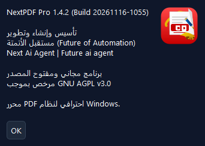
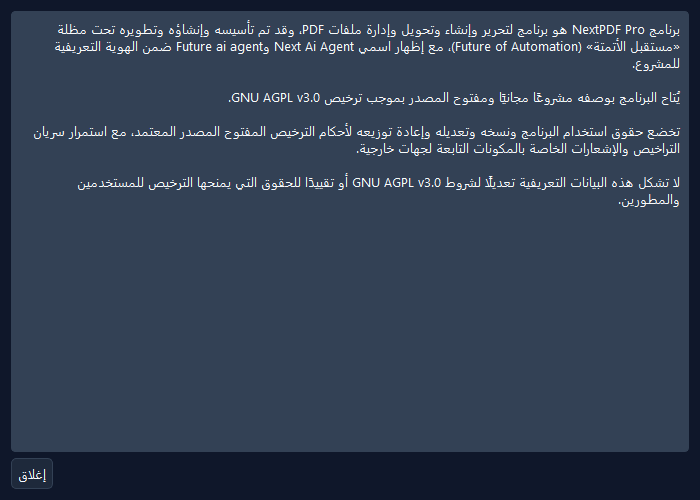
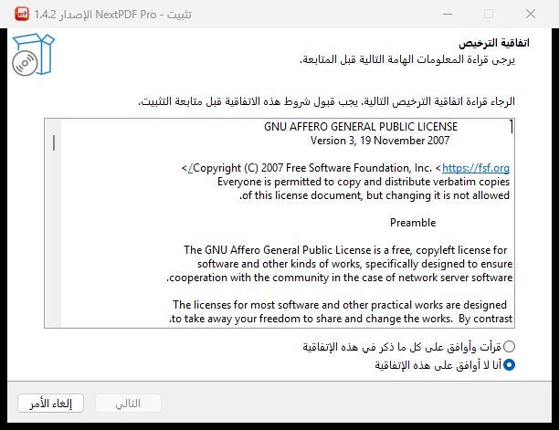

# NextPDF Pro

NextPDF Pro is a professional, open-source PDF editor for Windows, designed for Arabic/English workflows. It combines a modern Ribbon UI with searchable Arabic OCR, Office conversions, PDF creation/merging, theming, and full localization.

## Features

- **PDF Viewing & Editing** – Open, view, and edit PDF documents with PyMuPDF/MuPDF
- **Real Arabic text editing** – Text you add or edit is shaped with HarfBuzz and stored as logical Unicode, so it stays searchable, selectable and exportable after saving; editing a line replaces the whole line and leaves no stale glyphs
- **Searchable Arabic OCR** – Convert scanned images to searchable PDFs using Tesseract (Arabic, English, and mixed)
- **PDF Creation** – Create PDFs from images, text, DOCX, XLSX, PPTX, HTML, CSV; merge multiple images into one PDF
- **Office Conversions** – Export PDF to editable DOCX, PPTX, XLSX with Arabic RTL support
- **Ribbon Interface** – 11 tabs in Arabic and English, with tinted SVG icons and tooltips
- **Theming** – Light, Dark, and System themes with live switching (no document impact)
- **Localization** – Full Arabic/English UI with RTL layout; no mixed labels
- **Portable OCR, no separate engine** – Recognition runs on the Tesseract compiled into MuPDF, so the release ships only 5 MB of `ara`/`eng` language data instead of a 175 MB Tesseract runtime; no system installation required
- **Zoom** – Real QSlider zoom (10–800%) synced across views
- **Damaged text repair** – A PDF whose embedded font has no `ToUnicode` map is repaired from the font's own character map, or refused with a clear message; it is never exported as garbage
- **Borderless statement tables** – Tables drawn only with shading are detected from text alignment, keep real dates and amounts, and keep Arabic column order

## Screenshots

| About (Arabic) | About (English) |
|---|---|
|  |  |

| Terms (Arabic) | Terms (English) |
|---|---|
|  |  |

| Installer license page (Arabic) | Installer license page (English) |
|---|---|
|  |  |

## Requirements

- Windows 10/11 (x64)
- Python 3.12+ (for development from source)
- No Tesseract installation required (the engine is inside MuPDF)

## Building from Source

```bash
# Clone the repository
git clone https://github.com/hossamxp2025/NextPDF-Pro.git
cd NextPDF-Pro

# Create and activate a virtual environment
python -m venv .venv
.venv\Scripts\activate

# Install dependencies
pip install -r requirements.txt

# Install PyInstaller (for EXE build)
pip install pyinstaller

# Generate release metadata
python build/generate_metadata.py

# Build the standalone EXE (OneDir)
python build/build_exe.py

# Optional: Build the Inno Setup installer
python build/build_exe.py --installer
```

The build script writes to a versioned folder (`dist/release-<version>/`) so existing releases are never overwritten.

## Portable OCR

Recognition uses the Tesseract that is linked into MuPDF (`Pixmap.pdfocr_tobytes`), so no `tesseract.exe` and none of its dependency DLLs are shipped. Only `ara.traineddata` and `eng.traineddata` are bundled, under `resources/tessdata/`. No system Tesseract installation is needed.

## License

This project is licensed under the **GNU Affero General Public License v3.0** (AGPL-3.0). See [`LICENSE`](LICENSE) for the full text.

Third-party component notices are in [`THIRD_PARTY_NOTICES.md`](THIRD_PARTY_NOTICES.md).

## Project Identity

**Application:** NextPDF Pro  
**Established and developed by:** مستقبل الأتمتة — Future of Automation  
**Project identity:** Next Ai Agent | Future ai agent  
**Type:** Free & Open Source Software  
**License:** GNU AGPL v3.0

These credits describe the founding organization and project identity. They do not modify the GNU AGPL v3.0 license or restrict the rights it grants. Third-party components retain their respective licenses and copyright notices.

## Repository Structure

```
NextPDF-Pro/
├── src/                 # Application source code
├── tests/               # Test suite (pytest)
├── resources/           # Icons, fonts, OCR language data (tessdata)
├── build/               # PyInstaller spec, Inno Setup script, build scripts
├── docs/                # Documentation and evidence screenshots
├── LICENSE              # AGPL-3.0
├── THIRD_PARTY_NOTICES.md
├── README.md            # This file (English)
├── README_AR.md         # العربية (Arabic)
├── CONTRIBUTING.md
├── CHANGELOG.md
├── requirements.txt
└── .gitignore
```

## Testing

```bash
$env:QT_QPA_PLATFORM='offscreen'
$env:PYTHONIOENCODING='utf-8'
.\.venv\Scripts\python.exe -m pytest tests -q --tb=short -p no:cacheprovider
```

## Release Artifacts

- `dist/release-<version>/NextPDF-Pro.exe` – Standalone portable EXE (OneDir)
- `dist/release-<version>/NextPDF-Pro-Setup-<version>.exe` – Inno Setup installer
- SHA256 checksums in `SHA256SUMS.txt`