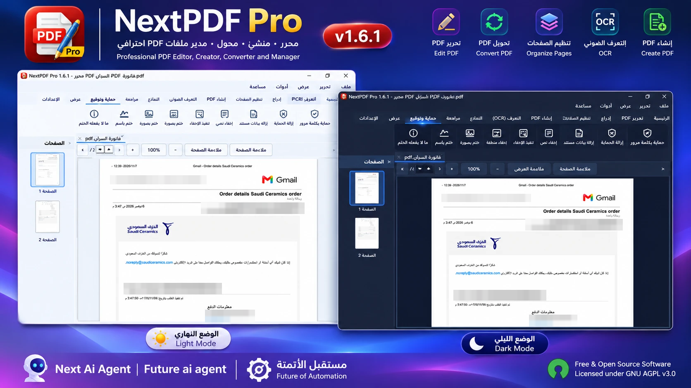
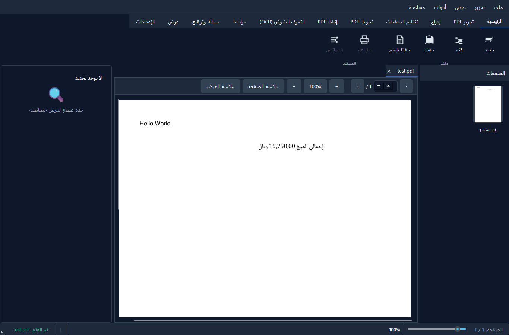
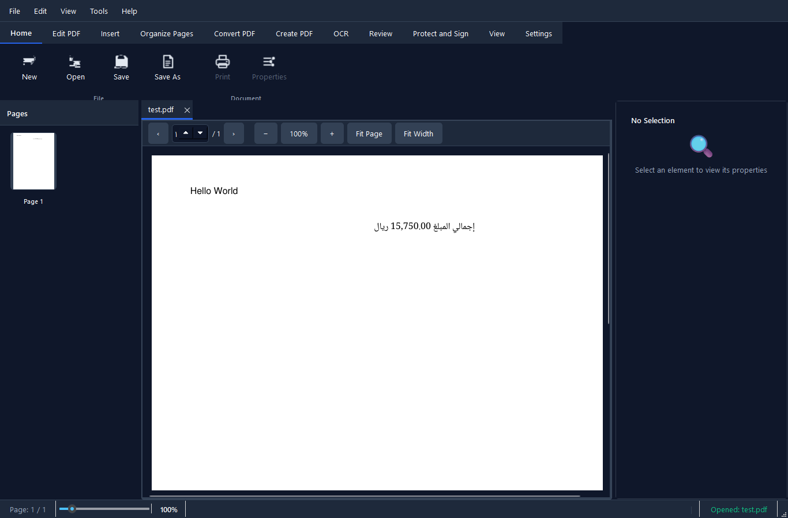
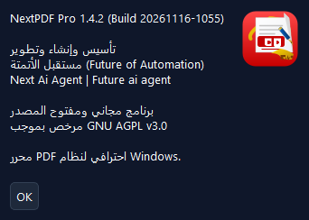
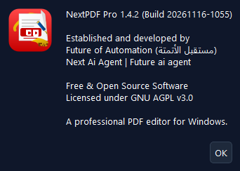
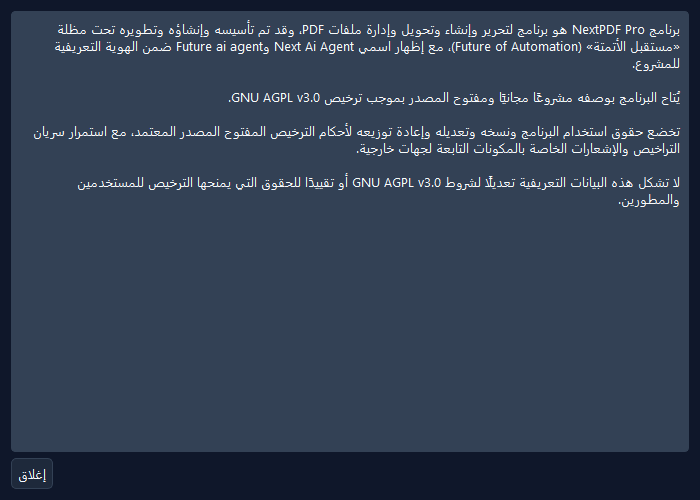
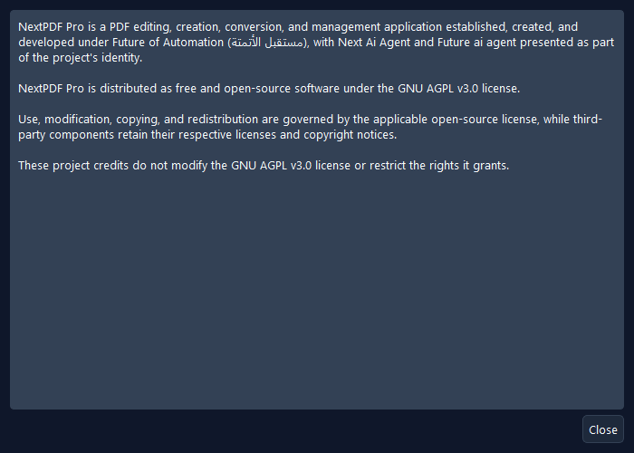

# NextPDF Pro



[](https://github.com/hossamxp2025/NextPDF-Pro/releases/latest)
[](https://github.com/hossamxp2025/NextPDF-Pro/releases)
[](LICENSE)


**[⬇️ تحميل أحدث إصدار](https://github.com/hossamxp2025/NextPDF-Pro/releases/latest)** · [English](README.md)

NextPDF Pro هو محرر PDF احترافي ومفتوح المصدر لنظام ويندوز، مصمم لسير العمل بالعربية والإنجليزية. يجمع بين واجهة شريط علوي حديثة، والتعرف الضوئي على الحروف (OCR) للغة العربية القابلة للبحث، وتحويلات مكتب أوفيس، وإنشاء ودمج ملفات PDF، والثيمات، والتعريب الكامل.

## الميزات

- **عرض وتحرير ملفات PDF** – فتح وعرض وتحرير مستندات PDF باستخدام PyMuPDF/MuPDF
- **تحرير عربي حقيقي** – النص الذي تضيفه أو تعدّله يُشكَّل بـ HarfBuzz ويُحفظ كـ Unicode منطقي، فيبقى قابلًا للبحث والتحديد والتصدير بعد الحفظ؛ وتعديل السطر يستبدله كاملًا بلا بقايا من النص القديم
- **التعرف الضوئي على الحروف باللغة العربية (OCR)** – تحويل الصور الماسحة إلى ملفات PDF قابلة للبحث باستخدام Tesseract (اللغة العربية، الإنجليزية، والمختلط)
- **إنشاء ملفات PDF** – إنشاء ملفات PDF من الصور، النصوص، DOCX، XLSX، PPTX، HTML، CSV؛ دمج عدة صور في ملف PDF واحد
- **تحويلات مكتب أوفيس** – تصدير ملفات PDF إلى DOCX قابلة للتحرير، PPTX، XLSX مع دعم اتجاه النص من اليمين إلى اليسار (RTL) للغة العربية
- **واجهة الشريط العلوي (Ribbon)** – 12 تبويبًا باللغتين العربية والإنجليزية، مع أيقونات SVG ملونة ونصائح تلميحية
- **الثيمات** – ثيمات فاتحة، غامقة، ونظام مع التبديل المباشر دون التأثير على المستندات
- **التعريب الكامل** – واجهة مستخدم كاملة بالعربية والإنجليزية مع اتجاه RTL؛ بدون خلط لغوي
- **OCR محمول بلا محرك منفصل** – التعرف يعمل على Tesseract المدمج داخل MuPDF، فالإصدار يحمل 5 ميجابايت من بيانات اللغة (ara وeng) بدل 175 ميجابايت من ملفات Tesseract التنفيذية؛ لا حاجة لتثبيت أي شيء على النظام
- **التكبير** – شريط انزلاقي حقيقي للتكبير (10–800%) متزامن عبر العروض
- **إصلاح النص التالف** – الملف الذي لا يحمل خطه المضمَّن خريطة `ToUnicode` تُعاد خرائطه من خريطة محارف الخط نفسه، أو يُرفض برسالة واضحة؛ ولا يُصدَّر خربوشًا أبدًا
- **جداول الكشوف بلا حدود** – الجداول المرسومة بالتظليل وحده تُكتشف من استقامة النص، وتحافظ على التواريخ والمبالغ الحقيقية وعلى ترتيب الأعمدة العربي
- **الحماية** – تشفير AES-256 بكلمة مرور فتح وكلمة مرور مالك، وصلاحيات للقارئ، وفتح الملفات المحمية، وإزالة الحماية بطلب صريح، وإزالة بيانات المستند. والحفظ العادي لا يُسقط الحماية
- **الإخفاء (Redaction)** – المحتوى المحدَّد يُحذف من الصفحة ولا يُغطّى، بالنص أو بتحديد منطقة بالسحب في العارض
- **التعليقات** – تظليل وملاحظة لاصقة ونص على الصفحة ومستطيل وبيضاوي وخط، كتعليقات PDF حقيقية يراها أي قارئ آخر؛ مع التحديد والتعديل والحذف وقائمة بالكل، وتراجع لكل خطوة. والنص العربي في تعليق FreeText مرفوض لأن خطوط PDF القياسية لا تشكّله
- **النماذج التفاعلية** – قراءة حقول AcroForms وتعبئتها وحفظها، وإنشاء حقل نص أو مربع اختيار أو قائمة اختيارات، وحذف حقل، وتثبيت النموذج. القيمة العربية تُحفظ كما كُتبت تمامًا، والتثبيت يعيد رسمها بخط يشكّلها
- **الضغط** – يُزيل ما لا يحتاجه الملف ويعيد ترميز الصور، ويبلّغ الحجم قبل وبعد؛ وإذا لم يوفّر شيئًا يقول ذلك ولا يكتب ملفًا أكبر
- **الختم المرئي** – صورة أو اسم مكتوب يُرسم على الصفحة كمحتوى للصفحة، بنسبه محفوظة، ويمكن جعل خلفية التوقيع الممسوح البيضاء شفافة؛ والاسم العربي يُشكَّل ويبقى قابلًا للبحث. **وهو ليس توقيعًا رقميًا** والواجهة تقول ذلك: لا يثبت من وضعه ولا يكشف تغييرًا يحدث بعده
- **إكمال التحويل** – دقة التصدير (72–600 DPI)، وMarkdown حقيقي بعناوين وجداول، وملفات صور مرقَّمة لنطاق صفحات، وقراءة آلية للصفحة الممسوحة مع تعليم الناتج أنه مقروء آليًا، وزرّا الطباعة وخصائص المستند

## لقطات الشاشة

### النافذة الرئيسية — العربية


### النافذة الرئيسية — الإنجليزية


| حول البرنامج — العربية | حول البرنامج — الإنجليزية |
|---|---|
|  |  |

| الشروط — العربية | الشروط — الإنجليزية |
|---|---|
|  |  |

## التحميل

نزّل أحدث إصدار من [صفحة الإصدارات](https://github.com/hossamxp2025/NextPDF-Pro/releases/latest):

| الملف | استخدمه لو… |
|---|---|
| `NextPDF-Pro-Setup-<version>.exe` | عايز تثبيت عادي مع اختصارات في قائمة ابدأ (مُستحسن) |
| `NextPDF-Pro.exe` | عايز نسخة محمولة في ملف واحد بدون تثبيت (حوالي 89MB) |
| `SHA256SUMS.txt` | للتحقق من سلامة الملف: `Get-FileHash .\NextPDF-Pro.exe -Algorithm SHA256` |

> الملفات غير موقّعة رقميًا حتى الآن، فقد يظهر تحذير Windows SmartScreen أول مرة. اختر **مزيد من المعلومات ← التشغيل على أي حال**، أو ابنِ البرنامج من المصدر.

## المتطلبات

- ويندوز 10/11 (x64)
- بايثون 3.12+ (للتطوير من المصدر)
- لا حاجة لتثبيت Tesseract (المحرك مدمج داخل MuPDF)

## البناء من المصدر

```bash
# استنساخ المستودع
git clone <رابط-المستودع>
cd NextPDF-Pro

# إنشاء وتنشيط البيئة الافتراضية
python -m venv .venv
.venv\Scripts\activate

# تثبيت التبعيات
pip install -r requirements.txt

# تثبيت PyInstaller (لبناء الملف التنفيذي)
pip install pyinstaller

# إنشاء بيانات الإصدار
python build/generate_metadata.py

# بناء الملف التنفيذي المستقل (ملف واحد)
python build/build_exe.py

# اختياري: بناء مثبت Inno Setup
python build/build_exe.py --installer
```

يكتب سكريبت البناء إلى مجلد مصدّر (`dist/release-<version>/`) بحيث لا يتم استبدال الإصدارات الموجودة.

## OCR المحمول

التعرف يستخدم Tesseract المدمج داخل MuPDF عبر `Pixmap.pdfocr_tobytes`، فلا يُشحن `tesseract.exe` ولا أي من مكتباته. المضمَّن هو `ara.traineddata` و`eng.traineddata` فقط تحت `resources/tessdata/`. لا حاجة لتثبيت Tesseract على النظام.

## الترخيص

هذا المشروع مرخص بموجب **الرخصة العمومية affine العامة من جنو الإصدار 3.0** (AGPL-3.0). راجع [`LICENSE`](LICENSE) للنص الكامل.

إشعارات المكونات الخارجية موجودة في [`THIRD_PARTY_NOTICES.md`](THIRD_PARTY_NOTICES.md).

## هيكل المستودع

```
NextPDF-Pro/
├── src/                 # كود مصدر التطبيق
├── tests/               # مجموعة الاختبارات (pytest)
├── resources/           # الأيقونات، الخطوط، بيانات لغات OCR (tessdata)
├── build/               # مواصفات PyInstaller، سكريبت Inno Setup، سكريبتات البناء
├── docs/                # التوث ولقطات الشاشة الدليلية
├── LICENSE              # AGPL-3.0
├── THIRD_PARTY_NOTICES.md
├── README.md            # هذا الملف (بالإنجليزية)
├── README_AR.md         # العربية (هذا الملف)
├── CONTRIBUTING.md
├── CHANGELOG.md
├── requirements.txt
└── .gitignore
```

## الاختبار

```bash
$env:QT_QPA_PLATFORM='offscreen'
$env:PYTHONIOENCODING='utf-8'
.\.venv\Scripts\python.exe -m pytest tests -q --tb=short -p no:cacheprovider
```

## ملفات الإصدار الناتجة

- `dist/release-<version>/NextPDF-Pro.exe` – ملف تنفيذي محمول مستقل (OneFile)
- `dist/release-<version>/NextPDF-Pro-Setup-<version>.exe` – مثبت Inno Setup
- مجموعات التحقق SHA256 في `SHA256SUMS.txt`
